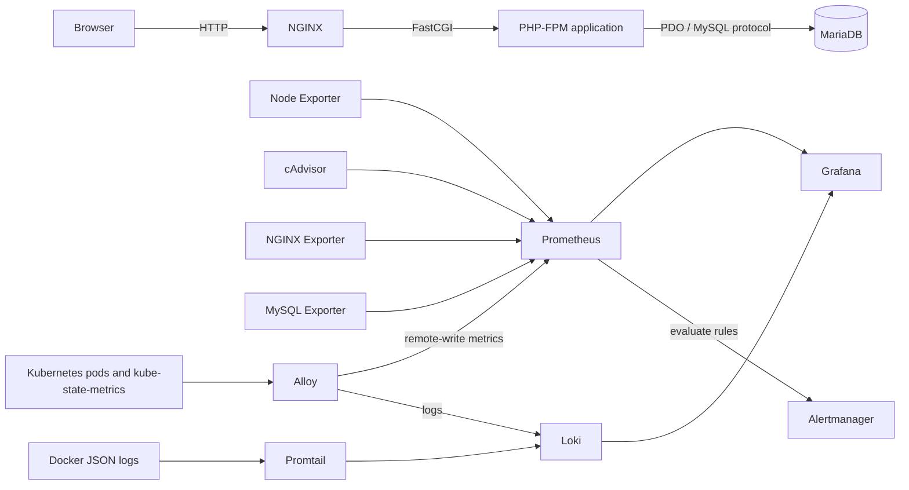
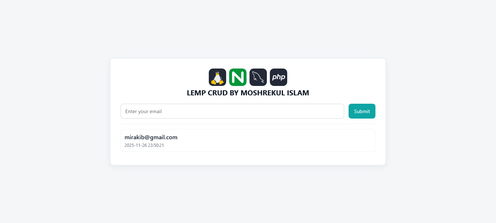
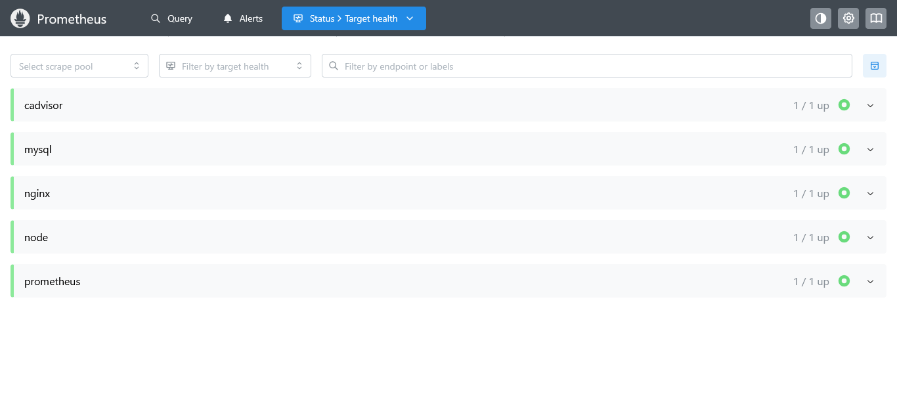
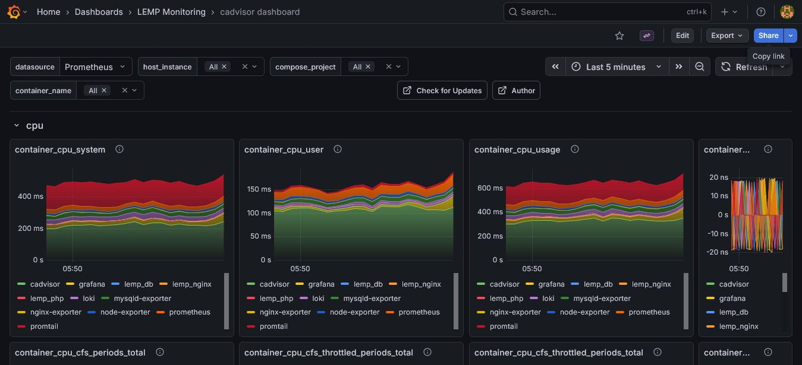
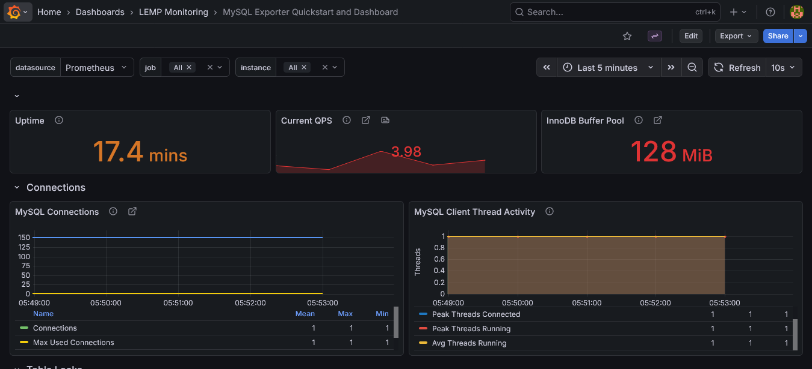
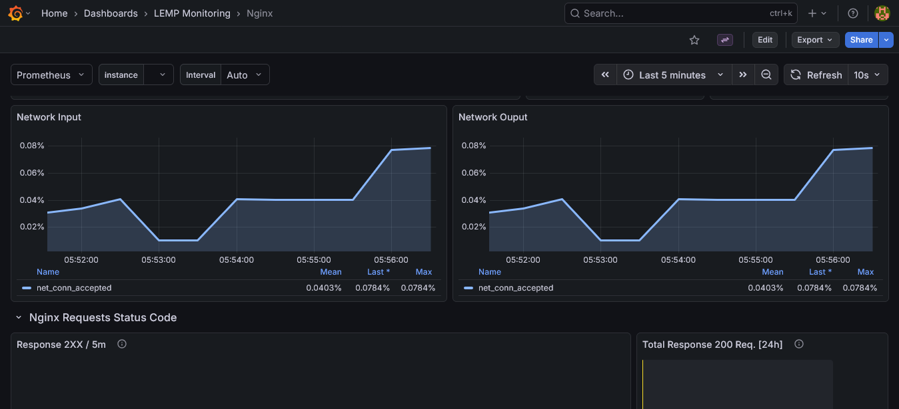
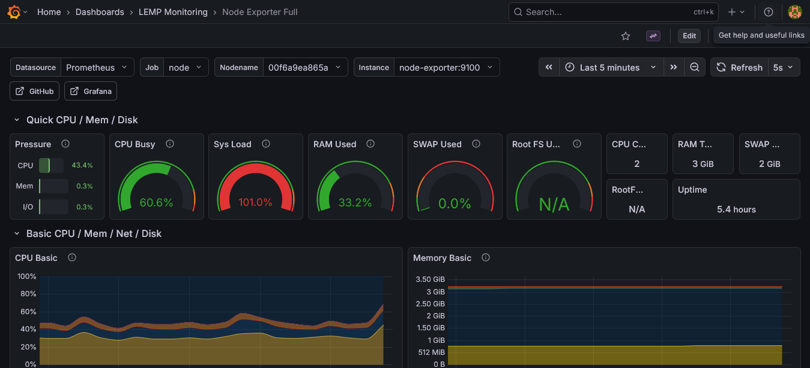

# LEMP Application Observability Lab

A hands-on observability project that runs a small PHP/MySQL application alongside a Docker Compose monitoring and logging stack. It brings together application hosting, infrastructure and service metrics, dashboards, alert delivery, and an optional Kubernetes telemetry experiment.

This is a learning and demonstration environment, not a production-hardened deployment. Several images use floating tags, metrics and exporter ports are published on the host, and some service credentials are intended only for local development. Review the security notes before exposing it beyond your machine.

## What the project does

- Hosts a PHP email-list CRUD application using PHP-FPM, NGINX, and MariaDB.
- Collects host and container metrics with Node Exporter and cAdvisor.
- Monitors NGINX and MariaDB through their Prometheus exporters.
- Scrapes metrics with Prometheus and evaluates a high-CPU alert rule.
- Visualizes metrics and logs in Grafana with provisioned Prometheus and Loki data sources and dashboards.
- Ships Docker container logs to Loki with Promtail.
- Optionally collects Kubernetes pod logs and kube-state-metrics through Grafana Alloy.

## Architecture



The Compose services communicate over the `lempnet` bridge network using service names (for example, `php` connects to `db`, and Grafana queries `http://prometheus:9090`). Named volumes retain MariaDB, Grafana, Loki, and Alloy data across container restarts.

### Services and responsibilities

| Service | Purpose |
| --- | --- |
| `nginx` | Serves the application and exposes NGINX stub status for its exporter. |
| `php` | Runs the PHP 8.4 application with PDO MySQL support using PHP-FPM. |
| `db` | Stores application email records in MariaDB. |
| `node-exporter` | Exposes host-level system metrics to Prometheus. |
| `cadvisor` | Exposes container resource metrics and a cAdvisor web page. |
| `nginx-exporter` | Converts NGINX stub status into Prometheus metrics. |
| `mysqld-exporter` | Exposes MariaDB server metrics to Prometheus. |
| `prometheus` | Scrapes configured targets every 5 seconds and evaluates alert rules. |
| `alertmanager` | Receives Prometheus alerts and routes the CPU alert to email. |
| `grafana` | Presents the provisioned dashboards and queries Prometheus and Loki. |
| `promtail` | Reads Docker JSON log files and pushes them to Loki. |
| `loki` | Stores and serves logs. |
| `alloy` | Optional Kubernetes pod-log collection and kube-state-metrics forwarding. |

### Telemetry paths

- **Metrics:** Node Exporter, cAdvisor, NGINX Exporter, and MySQL Exporter → Prometheus → Grafana.
- **Alerts:** Prometheus rule evaluation → Alertmanager → SMTP email. The configured `CPUUsageHigh` rule fires when measured CPU use exceeds 80% for one minute.
- **Docker logs:** Docker container JSON log files → Promtail → Loki → Grafana.
- **Optional Kubernetes metrics/logs:** kube-state-metrics → Alloy → Prometheus remote-write receiver; Kubernetes pod logs → Alloy → Loki.

## Technology and tools

- **Application:** PHP 8.4, PDO, MySQL-compatible SQL, HTML, and CSS.
- **Web and database:** NGINX, PHP-FPM, MariaDB.
- **Containerization:** Docker, Docker Compose, Alpine-based application images, named volumes, and a bridge network.
- **Metrics and alerting:** Prometheus, Node Exporter, cAdvisor, NGINX Prometheus Exporter, MySQL Exporter, Alertmanager.
- **Logs and visualization:** Grafana, Loki, Promtail, and Grafana Alloy.
- **Optional orchestration:** Kubernetes manifests, `kubectl`, kube-state-metrics, and Kubernetes RBAC.
- **Configuration and provisioning:** YAML, Alloy River configuration, SQL initialization, Prometheus rules, and Grafana dashboard JSON.

## Requirements

- Docker Desktop (Windows/macOS) or Docker Engine with the Docker Compose plugin (Linux).
- At least 2 GB of memory available to Docker is recommended.
- SMTP access if you want to test Alertmanager email notifications.
- For the optional Kubernetes integration: a running Kubernetes cluster, `kubectl`, and a usable kubeconfig at `$HOME/.kube/config`.

The Compose file includes Linux host mounts for cAdvisor and Docker log files. On Docker Desktop, host metrics and log-file collection depend on the Docker Desktop environment and may be incomplete or unavailable. The application and dashboard stack can still be used without the optional Kubernetes integration.

## Quick start

Run these commands from the repository root.

### 1. Create the local environment file

There is currently no `.env.example` in the repository. Create a local `.env` file and use these variable names; replace every example password with a strong, unique local value:

```dotenv
HOST_PORT=8088

DB_HOST=db
DB_NAME=appdb
DB_USER=appuser
DB_PASS=replace-with-a-strong-app-password

MYSQL_ROOT_PASSWORD=replace-with-a-strong-root-password
MYSQL_DATABASE=appdb
MYSQL_USER=appuser
MYSQL_PASSWORD=replace-with-a-strong-app-password

GRAFANA_USER=admin
GRAFANA_PASS=replace-with-a-strong-grafana-password
```

`DB_PASS` must match `MYSQL_PASSWORD`; `DB_NAME` must match `MYSQL_DATABASE`; and `DB_USER` must match `MYSQL_USER`. The checked-in SQL initialization script uses the database name `appdb`, so keep `DB_NAME` and `MYSQL_DATABASE` set to `appdb` unless you also update [db/init.sql](db/init.sql).

PowerShell users can create and edit the file with:

```powershell
@'
HOST_PORT=8088
DB_HOST=db
DB_NAME=appdb
DB_USER=appuser
DB_PASS=replace-with-a-strong-app-password
MYSQL_ROOT_PASSWORD=replace-with-a-strong-root-password
MYSQL_DATABASE=appdb
MYSQL_USER=appuser
MYSQL_PASSWORD=replace-with-a-strong-app-password
GRAFANA_USER=admin
GRAFANA_PASS=replace-with-a-strong-grafana-password
'@ | Set-Content -NoNewline .env
```

Use the same app password for `DB_PASS` and `MYSQL_PASSWORD`. Keep `.env` local; it is ignored by Git.

### 2. Create service configuration files

Compose mounts these local files, but only their example templates are checked in:

**PowerShell**

```powershell
Copy-Item alertmanager\alertmanager.yml.example alertmanager\alertmanager.yml
Copy-Item grafana\grafana.ini.example grafana\grafana.ini
New-Item -ItemType Directory -Force alertmanager\secrets | Out-Null
```

**Linux/macOS**

```sh
cp alertmanager/alertmanager.yml.example alertmanager/alertmanager.yml
cp grafana/grafana.ini.example grafana/grafana.ini
mkdir -p alertmanager/secrets
```

Edit `alertmanager/alertmanager.yml` and set your SMTP host, sender, SMTP username, and recipient. Create `alertmanager/secrets/smtp_password` containing only the SMTP password. For example:

```powershell
Set-Content -NoNewline alertmanager\secrets\smtp_password 'replace-with-your-smtp-password'
```

```sh
printf '%s' 'replace-with-your-smtp-password' > alertmanager/secrets/smtp_password
```

The secret file is mounted into Alertmanager as a Docker secret and is ignored by Git. Do not commit credentials or put the Alertmanager SMTP password in `.env`. Grafana's optional SMTP configuration is separate: configure its local `grafana/grafana.ini` and review `grafana/provisioning/alerting/contact-points.yml` if you intend to use Grafana-managed email alerts.

### 3. Start the stack

```sh
docker compose up --build -d
```

On installations using the older standalone Compose command, use `docker-compose up --build -d`. Check container status and startup logs:

```sh
docker compose ps
docker compose logs -f
```

The first build downloads base images and installs the PHP PDO MySQL extension. MariaDB runs `db/init.sql` when its data directory is first initialized.

### 4. Open the services

| Service | URL | Notes |
| --- | --- | --- |
| PHP application | `http://localhost:8088/` | Change `HOST_PORT` in `.env` to select another host port. |
| Grafana | `http://localhost:3000/` | Sign in with `GRAFANA_USER` and `GRAFANA_PASS` on first initialization. |
| Prometheus | `http://localhost:9090/` | Targets: `/targets`; rules: `/rules`; active alerts: `/alerts`. |
| Alertmanager | `http://localhost:9093/` | Alert status and routing UI. |
| Loki | `http://localhost:3100/` | API readiness endpoint: `/ready`; this is not a log-browsing UI. Use Grafana Explore. |
| cAdvisor | `http://localhost:8080/` | Container overview; metrics endpoint: `/metrics`. |
| Grafana Alloy | `http://localhost:12345/` | Alloy UI and component status. |
| Node Exporter | `http://localhost:9100/metrics` | Raw host metrics. |
| MySQL Exporter | `http://localhost:9104/metrics` | Raw MariaDB exporter metrics. |
| NGINX Exporter | `http://localhost:9113/metrics` | Raw NGINX exporter metrics. |
| NGINX stub status | `http://localhost:8088/nginx_status` | Internal source used by the NGINX exporter; host port follows `HOST_PORT`. |

MariaDB is not published to a host port; PHP and the exporter reach it over the Compose network. Promtail also has no published host port.

In Grafana, the Prometheus and Loki data sources and four dashboards (cAdvisor, MySQL Exporter, NGINX, and Node Exporter Full) are provisioned from the files under `grafana/provisioning/`.

## Application behavior and routes

The application is a single PHP entry point at `src/public/index.php`. It lists stored email addresses and supports create, edit, and delete operations:

| Operation | Request |
| --- | --- |
| List records | `GET /` |
| Create record | `POST /?action=create` with an `email` field |
| Load an edit form | `GET /?action=edit&id=<id>` |
| Update a record | `POST /?action=update` with `id` and `email` fields |
| Delete a record | `GET /?action=delete&id=<id>` |

Email values are validated with PHP's email filter, database statements use PDO prepared statements, and output values are HTML-escaped. The schema is defined in `db/init.sql`; NGINX serves static files and forwards PHP requests to PHP-FPM over FastCGI.

## Configuration and changing files

| File or directory | Purpose | How to change it |
| --- | --- | --- |
| `.env` | Compose substitutions for host port, app/database credentials, and Grafana credentials. | Create locally from the variable list above; never commit it. |
| `alertmanager/alertmanager.yml.example` | SMTP and alert routing template. | Copy to the ignored `alertmanager/alertmanager.yml`, then configure SMTP and recipient. |
| `alertmanager/secrets/smtp_password` | Alertmanager SMTP password file. | Create locally; keep it out of Git. |
| `grafana/grafana.ini.example` | Grafana SMTP settings template. | Copy to the ignored `grafana/grafana.ini` and configure only if needed. |
| `mysqld-exporter/.my.cnf` | Tracked exporter client configuration; the current Compose service does not mount it. | Do not put real credentials here. Compose supplies the exporter connection settings separately. |
| `prometheus/prometheus.yml` | Scrape targets, scrape interval, and Alertmanager connection. | Update the file when adding or changing Prometheus targets. |
| `prometheus/alerts.yml` | Prometheus alert rules and thresholds. | Edit the expression, duration, labels, or annotations as needed. |
| `nginx/default.conf` | Application routing and NGINX `stub_status` endpoint. | Update the server configuration and exporter scrape path together. |
| `db/init.sql` | Initial database, table, and exporter-user setup. | Changes apply to a newly initialized database volume; see the data note below. |
| `grafana/provisioning/` | Datasources, dashboard provisioning, alert contact point. | Edit YAML or add dashboard JSON under `dashboards_files/`. |
| `loki/local-config.yaml` | Loki server, storage, and schema settings. | Adjust Loki configuration and storage with care. |
| `promtail/config.yml` | Host Docker log discovery and Loki destination. | Change log paths, labels, or destination as needed. |
| `alloy/config.alloy` | Optional Kubernetes pod log and metrics pipeline. | Update discovery, labels, scrape target, or write endpoints. |
| `kubernetes/` | kube-state-metrics and log-generator Kubernetes resources. | Review RBAC and namespace settings before applying to a cluster. |

The root `.gitignore` excludes `.env`, `alertmanager.yml`, `smtp_password`, and `grafana.ini`. Keep secrets in those local files; commit changes to the corresponding `.example` templates only when they contain placeholders and safe defaults. Verify ignored files before committing with `git status --short` and `git check-ignore -v .env alertmanager/alertmanager.yml alertmanager/secrets/smtp_password grafana/grafana.ini`.

`mysqld-exporter/.my.cnf` is currently tracked and is not covered by `.gitignore`; it is also not mounted by the Compose service. Do not add real credentials to it. To stop tracking it while keeping your local copy, add `.my.cnf` to `.gitignore`, then stage its removal from the repository with `git rm --cached mysqld-exporter/.my.cnf`. If a real credential was ever committed, rotate it; ignoring the file does not remove it from Git history.

After changing Compose environment values, recreate affected containers with:

```sh
docker compose up -d
```

A changed database or Grafana password in `.env` does not automatically rotate credentials already stored in the persistent database/Grafana data. Rotate those credentials in the service itself as appropriate. Likewise, `db/init.sql` runs only when MariaDB initializes an empty data directory; it is not a migration mechanism.

## Optional Kubernetes integration

Alloy expects the host kubeconfig to be available at `$HOME/.kube/config`, mounted by Compose at `/etc/alloy/kubeconfig`. On Windows with Docker Desktop, check that the Compose `${HOME}` path resolves to a directory Docker can share. A running cluster is required to use this feature.

Apply the Kubernetes resources in dependency order:

```sh
kubectl apply -f kubernetes/namespace.yaml
kubectl apply -f kubernetes/kube-state-metrics-rbac.yaml
kubectl apply -f kubernetes/kube-state-metrics-deployment.yaml
kubectl apply -f kubernetes/kube-state-metrics-service.yaml
kubectl apply -f kubernetes/log-test.yaml
```

The kube-state-metrics Service is `ClusterIP`, so Alloy's configured `host.docker.internal:8081` target requires a host port-forward. In another terminal, run:

```sh
kubectl -n monitoring port-forward service/kube-state-metrics 8081:8080
```

Keep the port-forward running while using this integration. Check the Alloy UI at `http://localhost:12345/`, Prometheus targets at `http://localhost:9090/targets`, and query Kubernetes pod logs in Grafana Explore using the Loki data source. The example log generator emits a test line every five seconds in the `log-test` namespace.

Remove the optional Kubernetes resources when finished:

```sh
kubectl delete -f kubernetes/log-test.yaml
kubectl delete -f kubernetes/kube-state-metrics-service.yaml
kubectl delete -f kubernetes/kube-state-metrics-deployment.yaml
kubectl delete -f kubernetes/kube-state-metrics-rbac.yaml
kubectl delete -f kubernetes/namespace.yaml
```

The RBAC manifest grants cluster-wide list/watch access to the resource types kube-state-metrics needs. Review those permissions and adapt them to your cluster before using this example in a shared environment.

## Useful Docker Compose commands

```sh
docker compose ps                    # list service status
docker compose logs -f prometheus    # follow one service's logs
docker compose restart grafana       # restart a service
docker compose down                  # stop and remove containers and network
```

`docker compose down` preserves named volumes. To remove **all stored database, Grafana, Loki, and Alloy data** and force MariaDB to run `db/init.sql` on the next start:

```sh
docker compose down -v
```

This permanently deletes the data in those Compose volumes. Use it only when that reset is intended.

## Troubleshooting

- **Compose reports unset variables:** Check that `.env` is in the repository root and contains every variable in the Quick start section.
- **Compose cannot mount a config or secret:** Confirm that the local `alertmanager/alertmanager.yml`, `grafana/grafana.ini`, and `alertmanager/secrets/smtp_password` files exist. The `.example` templates are not the mounted filenames.
- **The app cannot connect to MariaDB:** Check `docker compose logs db php`, confirm the app and MariaDB credentials match in `.env`, and allow the database time to initialize on its first start.
- **A changed DB password appears ineffective:** MariaDB initialization variables only create credentials on an empty data volume. Update the existing database user or intentionally reset the volume; do not expect changing `.env` alone to alter an existing account.
- **Prometheus shows a target as down:** Open `/targets`, then inspect the relevant exporter and monitored service logs. Scrape target names in `prometheus/prometheus.yml` are Compose DNS names, not host `localhost` addresses.
- **No container logs appear in Loki:** Check Promtail logs and confirm Docker is writing JSON log files at the mounted path. Docker Desktop may not expose the Linux Docker log directory to the Promtail container.
- **No Kubernetes telemetry appears:** Verify the kubeconfig mount, cluster access, Alloy status, `kubectl` resources, and the `8081:8080` port-forward.
- **SMTP alerts do not arrive:** Check SMTP host, sender, recipient, credentials, TLS settings, Alertmanager status, and `docker compose logs alertmanager`. Prometheus must first fire an alert for Alertmanager to send it.

## Technical notes and security

- This repository is a local learning project. Do not expose it directly to the public internet without adding authentication, TLS, firewall restrictions, secret management, and least-privilege service configuration.
- Compose publishes Prometheus, Grafana, Alertmanager, Loki, Alloy, cAdvisor, and exporter ports on the host. Restrict host access if other machines can reach the development computer.
- NGINX's `/nginx_status` endpoint is configured with `allow all`; restrict it to trusted networks before deployment outside a local lab.
- The MySQL Exporter password (`exporterpass`) is configured in the Compose command/environment and in `db/init.sql`. Replace it consistently in both files before using this stack with sensitive data.
- Several images use `latest` or other floating tags. Pin and test explicit versions for reproducible or production deployments.
- The Compose stack uses a single bridge network and local filesystem-backed Loki storage; it does not provide high availability, centralized secret management, TLS, or backups.
- Promtail is included as the Docker log collector in this project. For a new deployment, review the currently supported Grafana log collection options before adopting or extending this lab.

## Skills demonstrated and learning outcomes

Working through this project exercises:

- Building and connecting a multi-container application with Docker Compose, service discovery, environment variables, bind mounts, named volumes, and secrets.
- Serving PHP through NGINX and PHP-FPM, connecting PHP PDO to MariaDB, and initializing a relational schema.
- Instrumenting infrastructure and services with exporters and configuring Prometheus scrape jobs.
- Writing a threshold-based Prometheus alert and routing notifications with Alertmanager and SMTP.
- Provisioning Grafana data sources and dashboards from version-controlled configuration.
- Collecting, labeling, storing, and querying container logs with Promtail, Loki, and Grafana.
- Extending an existing Docker observability stack to Kubernetes using service discovery, RBAC, kube-state-metrics, Alloy, port forwarding, logs, and Prometheus remote write.
- Diagnosing telemetry pipelines by checking service health, scrape targets, container logs, configuration files, and persistent state.

## Screenshots

| Application | Prometheus | cAdvisor |
| --- | --- | --- |
|  |  |  |

| MySQL Exporter dashboard | NGINX Exporter dashboard | Node Exporter dashboard |
| --- | --- | --- |
|  |  |  |

## Repository layout

```text
.
├── alertmanager/       # Alert routing example
├── alloy/              # Grafana Alloy Kubernetes pipelines
├── db/                 # MariaDB initialization SQL
├── grafana/            # Grafana example config, provisioning, dashboards
├── Images/             # Project screenshots
├── kubernetes/         # kube-state-metrics and log-test manifests
├── loki/               # Loki configuration
├── mysqld-exporter/    # MySQL Exporter client configuration
├── nginx/              # NGINX virtual-host configuration
├── prometheus/         # Prometheus scrape jobs and alert rules
├── promtail/           # Docker log collection configuration
├── src/                # PHP application and CSS
├── docker-compose.yml  # Local multi-service stack
└── Dockerfile          # PHP-FPM image build
```
